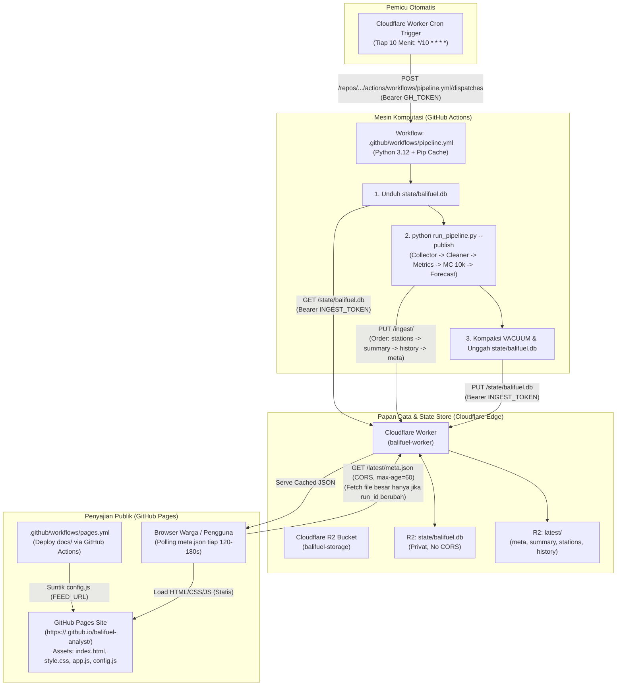

# Arsitektur Otomasi & Publikasi Bali Fuel Crisis Analyst

Dokumen ini menjelaskan rancangan arsitektur, aliran data, keamanan, batas kuota gratis, langkah konfigurasi, serta panduan pembersihan riwayat git untuk sistem **Bali Fuel Crisis Analyst**.

---

## 1. Diagram Arsitektur Sistem



---

## 2. Prinsip Pemisahan & Keamanan

1. **Frontend & Runner Terpisah Total**:
   - Frontend GitHub Pages (`docs/`) tidak pernah memanggil runner GitHub Actions secara langsung.
   - Runner tidak pernah melakukan `git commit` atau `git push`, sehingga eksekusi pipeline data **tidak memicu redeploy GitHub Pages**.
   - Runner dan Frontend hanya bertemu di **Cloudflare Worker + R2** sebagai papan data (*data board*).
2. **Keamanan Kredensial**:
   - `INGEST_TOKEN`: Token rahasia dengan verifikasi waktu-konstan (*constant-time* via `crypto.subtle.timingSafeEqual`) pada Worker. Mencegah serangan *timing attack*.
   - `GH_TOKEN`: Personal Access Token GitHub yang hanya disimpan di secret Worker untuk memicu `workflow_dispatch`.
   - `FEED_URL`: Variabel publik repositori (disuntikkan ke `_site/config.js` saat build Pages tanpa di-commit ke git).
   - Seluruh rute `/state/*` bersifat privat (tanpa header CORS) dan menolak akses publik.

---

## 3. Kontrak Data (`latest/`)

Setiap berkas JSON memuat `run_id` unik untuk menjamin konsistensi pembacaan di sisi klien:

| Berkas Kontrak | Target Ukuran | Isi Utama |
| :--- | :---: | :--- |
| **`meta.json`** | **< 2 KB** (diunggah TERAKHIR) | `run_id`, stempel waktu (UTC/WITA), `data_as_of`, `data_age_min`, `status` (`ok\|degraded\|stale`), skor CSI, median pemulihan, interval kredibel 50%/80%, `sources_ok`, `sources_failed`, `pipeline_version`. |
| **`summary.json`** | **< 150 KB** | Agregasi keparahan pulau, metrik 14 area makro, histogram Monte Carlo, kurva CDF, perbandingan 4 skenario, sensitivitas parameter, 20 hotspot rentan, kondisi maritim/cuaca, dan timeline berita. |
| **`stations.json`** | **< 1.5 MB** | 876 stasiun (SPBU + Pertamini): id, nama, area, lat/lng, status, antrean, harga Pertalite, dan trajektori 72 jam (P10/P50/P90) dalam format 2 desimal. |
| **`history.json`** | **< 10 KB** | Deret waktu CSI per jam (14 hari) dan riwayat prediksi run sebelumnya untuk evaluasi stabilitas model. |

**Urutan Unggah Wajib**:  
`stations.json` $\rightarrow$ `summary.json` $\rightarrow$ `history.json` $\rightarrow$ **`meta.json` (Terakhir)**.  
Klien browser hanya mengambil berkas besar jika mendeteksi nilai `run_id` baru pada `meta.json`.

---

## 4. Analisis Batas Kuota Gratis (Free Tier Feasibility)

Sistem ini dirancang sangat hemat dan beroperasi jauh di bawah batas kuota gratis Cloudflare dan GitHub Actions:

### A. Cloudflare R2:
- **Operasi Kelas A (Tulis/PUT)**:
  * 1 run pipeline = 4 file kontrak (`latest/`) + 1 state database (`state/`) = 5 operasi PUT.
  * 144 run per hari (tiap 10 menit) $\approx 720$ operasi tulis/hari = **~21.600 operasi/bulan**.
  * Batas Kuota Gratis R2: **1.000.000 operasi/bulan** $\rightarrow$ **Hanya terpakai 2,16%**.
- **Operasi Kelas B (Baca/GET)**:
  * Worker membaca R2 hanya saat cache edge kedaluwarsa (`max-age=60`).
  * Batas Kuota Gratis R2: **10.000.000 operasi/bulan** $\rightarrow$ Terpakai < 5%.
- **Penyimpanan**: Basis data SQLite dipangkas rolling 14 hari dengan `VACUUM` (< 15 MB). Batas gratis R2: **10 GB**.

### B. Cloudflare Workers:
- 144 pemicu Cron per hari + request polling publik.
- Dengan polling klien tiap 120–180 detik dan pembacaan `meta.json` (< 1 KB) yang didukung `ETag / 304 Not Modified`, 1.000 pengguna aktif hanya mengonsumsi &plusmn;30.000 request/hari.
- Batas Kuota Gratis Worker: **100.000 request/hari** $\rightarrow$ **Aman**.

### C. GitHub Actions:
- Pipeline berjalan &plusmn;40–50 detik per run karena komputasi Monte Carlo telah tervektorisasi dengan NumPy dan pembuatan SVG di-skip di CI.
- Batas Gratis Akun Publik GitHub: **Unlimited runner minutes untuk repositori publik**.

---

## 5. Panduan Konfigurasi Langkah-demi-Langkah

### Langkah 1: Setup Cloudflare Worker & R2
1. Pastikan bucket R2 `balifuel-storage` sudah terbuat:
   ```bash
   npx wrangler r2 bucket create balifuel-storage
   ```
2. Buat token acak untuk `INGEST_TOKEN`:
   ```bash
   # Contoh token acak
   openssl rand -hex 24
   ```
3. Pasang secret ke Cloudflare Worker:
   ```bash
   cd worker
   npx wrangler secret put INGEST_TOKEN
   # Masukkan token acak di atas saat diminta

   npx wrangler secret put GH_TOKEN
   # Masukkan GitHub Personal Access Token (PAT) dengan izin 'repo' dan 'workflow'
   ```
4. Deploy Worker ke Cloudflare:
   ```bash
   npx wrangler deploy
   ```
   Catat URL Worker yang dihasilkan (misal: `https://balifuel-worker.<subdomain>.workers.dev`).

---

### Langkah 2: Setup GitHub Repositori
Masuk ke halaman repositori di GitHub:

1. **Aktifkan GitHub Pages**:
   - Buka: **Settings** $\rightarrow$ **Pages**
   - Di bagian **Build and deployment** $\rightarrow$ **Source**: Pilih **GitHub Actions** (BUKAN "Deploy from a branch").
2. **Tambahkan Repository Secrets**:
   - Buka: **Settings** $\rightarrow$ **Secrets and variables** $\rightarrow$ **Actions** $\rightarrow$ Tab **Secrets**
   - Tambahkan Secret baru:
     * `WORKER_URL`: URL Cloudflare Worker Anda (contoh: `https://balifuel-worker.<subdomain>.workers.dev`)
     * `INGEST_TOKEN`: Token rahasia yang sama dengan yang dipasang di Worker.
     * `AISSTREAM_KEY` *(Opsional)*: Kunci API pelacakan tanker maritim dari aisstream.io jika ada.
3. **Tambahkan Repository Variable (FEED_URL)**:
   - Di halaman yang sama, buka tab **Variables**.
   - Tambahkan Variable baru:
     * Nama: `FEED_URL`
     * Nilai: URL Cloudflare Worker Anda tanpa garis miring di akhir (contoh: `https://balifuel-worker.<subdomain>.workers.dev`).

---

## 6. Pembersihan Riwayat Git (Instruksi `git filter-repo`)

⚠️ **PERINGATAN PENTING**:
Riwayat git saat ini menyimpan commit awal yang menyertakan file database lokal berukuran puluhan megabita. **Jangan jalankan perintah pembersihan riwayat secara otomatis tanpa konfirmasi pengguna**, karena ini akan menulis ulang hash commit (*force push*).

Jika Anda ingin merampingkan ukuran repositori `.git` di masa mendatang, ikuti instruksi berikut:

```bash
# 1. Pastikan git-filter-repo terpasang
pip install git-filter-repo

# 2. Buat cadangan klon repositori terlebih dahulu
cd ..
git clone --bare https://github.com/Sparkplugx1904/balifuel-analyst.git balifuel-analyst-backup.git
cd balifuel-analyst

# 3. Jalankan pembersihan file besar dari seluruh riwayat
git filter-repo --invert-paths \
  --path data/balifuel.db \
  --path-glob "data/raw/*" \
  --path-glob "data/clean/*.parquet" \
  --path-glob "data/clean/station_forecasts.json"

# 4. Hubungkan kembali remote dan force push (SETELAH KONFIRMASI)
git remote add origin https://github.com/Sparkplugx1904/balifuel-analyst.git
git push origin --force --all
```
*(Selalu lakukan konfirmasi manual sebelum menjalankan langkah ke-3 dan ke-4).*
